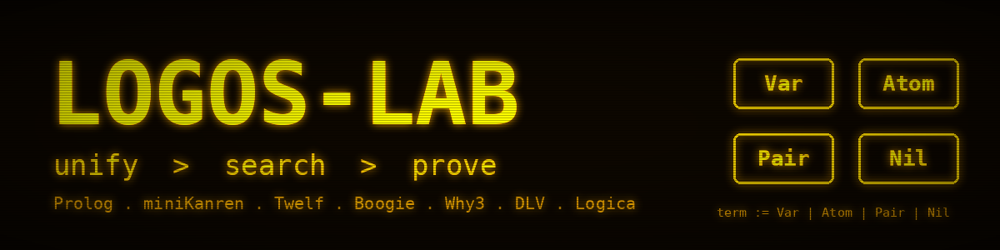
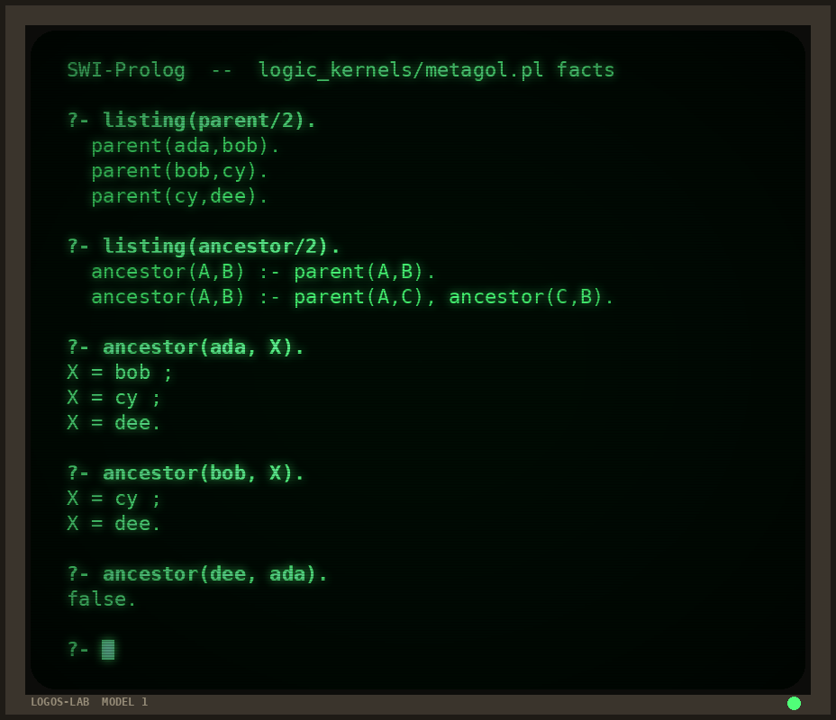
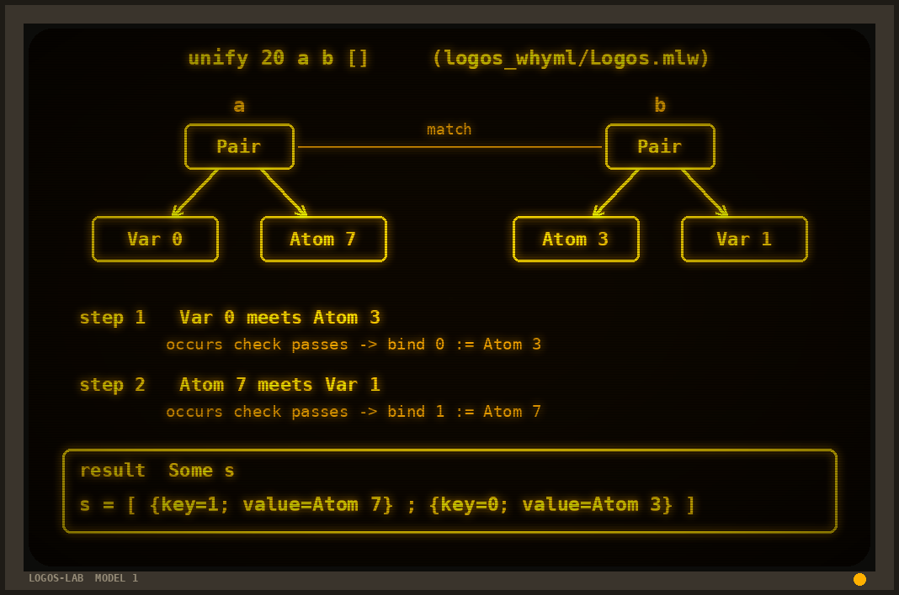
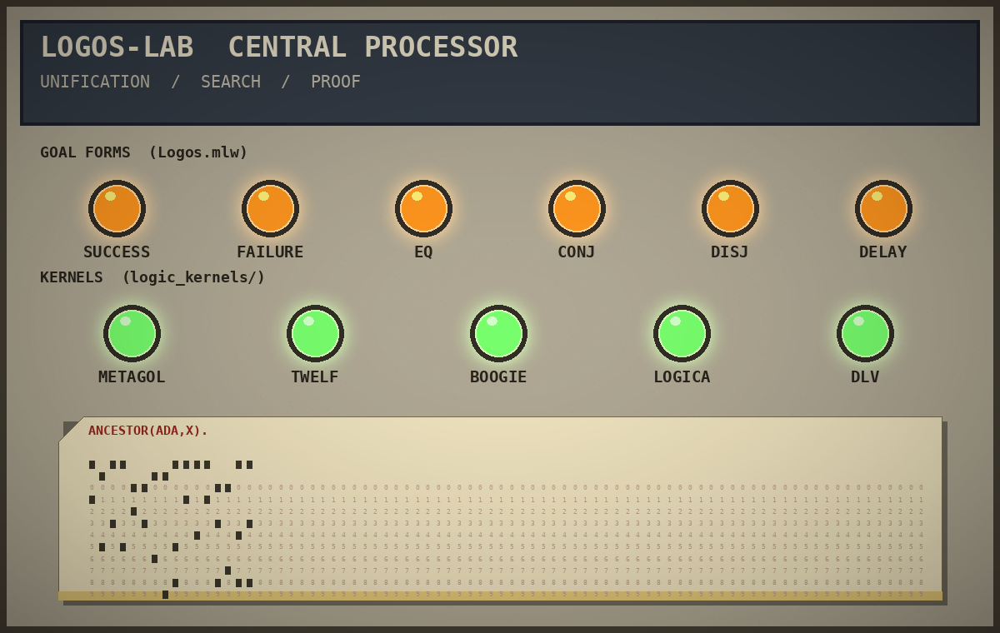

<p align="center"></p>

# logos-lab

Logic programming, from a unifier to a lexicon. Facts and rules go in, and answers come out by unification and search.

## The production stack

The production stack is a parallel logic-based AI machine. Facts and rules say what is true, and the search that finds the answers is a separate choice, so the logic stays the same whether the answers come from one depth-first, backtracking walk or from many branches explored side by side. Each part of the lab is its own independent piece of logic, and the parts run at the same time:

```sh
sh scripts/run_all.sh
```

That starts the etymology rules, the lexicon and deduction modules, the Logic Stack in Prolog, C, Haskell and OCaml, the Boogie proofs, the execution lock, the Ruby tool and the archive check together, one job per part, and prints what each one answers. `JOBS=2` limits how many run at once.

For a steady production run on SWI-Prolog there is the gardener:

```sh
sh scripts/gardener.sh
```

It runs each SWI-Prolog part one after another (etymology, lexicon, deduction, both Logic Stacks, the execution lock and the WAM), keeps a log per part in `logs/`, and prints a PASS or FAIL line for each. It runs well from cron or a systemd timer, and `logs/status.txt` always holds the last pass.

## A short history

Logic programming is the idea that a program can be a set of facts and rules, and that running it means asking a question and letting the machine search for answers. These are the systems behind the code in this lab.

- **Prolog.** Alain Colmerauer and Philippe Roussel built the first Prolog in Marseille around 1972. Robert Kowalski supplied the idea behind it, the procedural reading of Horn clauses: a rule can be read as a logical statement and as a procedure to run. David H. D. Warren's DEC-10 Prolog at the end of the 1970s made Prolog fast, and his Warren Abstract Machine became the model that most Prolog systems still follow. In 1982 Japan launched the Fifth Generation Computer Systems project and put logic programming at the center of it.
- **Datalog.** Grew out of deductive database research in the late 1970s and 1980s. It keeps the facts-and-rules style of Prolog and drops the function symbols, so every question has a finite answer.
- **miniKanren and microKanren.** Daniel Friedman and William Byrd built miniKanren for relational programming in Scheme, where a program runs forwards and backwards. Jason Hemann and Daniel Friedman distilled it into microKanren in 2013, a core small enough to read in one sitting. `Logos.mlw` follows that shape.
- **Twelf.** Frank Pfenning and Carsten Schürmann built Twelf around 1999 as an implementation of LF, the logical framework where a proof is a typed term and checking the proof is checking the type.
- **Boogie.** A Microsoft Research intermediate language and verifier. Programs are written with preconditions, postconditions and loop invariants, and the tool proves them. Other verifiers translate into it.
- **Why3.** A deductive verification platform from Inria. Its language, WhyML, holds programs and their specifications together and hands the proof obligations to automatic provers.
- **Metagol.** Stephen Muggleton and Andrew Cropper's system for inductive logic programming, the field where a program learns rules from examples. Metagol does it by meta-interpretive learning: give it facts, positive and negative examples and a few rule shapes, and it writes the clauses.
- **DLV.** An answer set programming system from Nicola Leone and colleagues in Vienna and Calabria, built on the stable model semantics of Gelfond and Lifschitz. A program describes the choices, and the answers are the consistent ways to make them.
- **Logica.** Google's Datalog-like language that compiles to SQL, so a few lines of rules run on a database engine.

## The engine

[`logos_whyml/Logos.mlw`](logos_whyml/Logos.mlw) is a microKanren-style engine written in WhyML for Why3.

- **Terms:** variables, atoms, pairs and nil.
- **Substitutions:** a list of bindings. `walk` follows a variable through them, and `occurs` is the occurs check.
- **`unify`:** matches two terms and extends the substitution, or fails.
- **Goals:** `Success`, `Failure`, `Eq`, `Conj` (and), `Disj` (or) and `Delay`.
- **`solve`:** runs a goal against a substitution and returns every answer, with a fuel counter so every call ends.

## Five kernels

[`logic_kernels/`](logic_kernels/) shows one small program in each of five logic systems.

| File | System | What it does |
|---|---|---|
| `metagol.pl` | Metagol | Learns `ancestor/2` from `parent/2` and positive and negative examples |
| `twelf.elf` | Twelf | Proves `path a c` by chaining edges `a b` and `b c` |
| `boogie.bpl` | Boogie | Proves a loop sums 1 to n as n(n+1)/2, using loop invariants |
| `logica.l` | Logica | Two-hop reachability over a small graph, compiled to SQL |
| `dlv.dl` | DLV | Assigns each task to the CPU or the GPU, exactly one of the two |

## Etymology

[`logos_etymology/`](logos_etymology/) turns a word table into Prolog facts.

- `ingest.awk` reads four tables (words, derivation edges, morphemes, senses) and writes the matching Prolog facts, one source on every row.
- `axioms.pl` holds the rules: `ancestor/2` and `ancestor_via/3` follow `derived_from/3` without looping, `shared_root/3` and `shared_ancestor/3` link related words, and `segmentation/2`, `gloss/2` and `spelling/2` read a word back.
- `LogosLexicon.mlw` is the typed model of a lexeme, its slices, morphemes, edges and senses.
- Every derivation edge carries its source, so each answer traces back to evidence.

```sh
cd logos_etymology
make query
```

## The WAM

[`wam/`](wam/) is a Warren Abstract Machine written in C. It keeps the heap, the registers, the choice points, the trail and the cut, so the search and the unification live in one engine. You send it tokens from a file or a pipe, and it prints the answers, or all of them with `-all`.

- `wam.c` is the engine. `-trace` prints every instruction it runs.
- `emit.pl` reads ordinary ISO Prolog (operators, quoted atoms, lists, strings, cut, if-then-else, negation) and writes the tokens.
- `examples/` has ancestor, append, member, cut and control programs, with their answers in `runs/`.

```sh
cd wam && make
swipl -q emit.pl -- examples/append.pl | ./wam -all -
```

The token grammar is in [`docs/wam.md`](docs/wam.md).

## Legacy logic archive

[`legacy-logic-archive/`](legacy-logic-archive/) stores historical Prolog, ALGOL, COBOL II and JOVIAL source by SHA-256 fingerprint. Each file has a record of its address, size, time and rights. `bin/collect.sh` fetches approved sources, `bin/verify.sh` re-hashes everything, and `research/` holds the notes on each phase, from NASA Prolog to the Mark I Perceptron.

```sh
cd legacy-logic-archive && bash bin/verify.sh
```

## What each folder is

### `logos_whyml/`: the engine

Unification plus search. `unify` is the matching step, where two terms are made equal by binding variables, and `solve` is the search step, where goals are tried in turn and every answer is collected. The same two ideas sit under Prolog, miniKanren and the rest of this lab. Here they are written as a typed, terminating program, so Why3 can state what they promise.

### `logic_kernels/`: five reasoning styles

One tiny program per system, each showing a different way of getting to an answer.

- **Learning from examples** with Metagol: the rule `ancestor/2` is found from `parent/2`.
- **Proof as a typed term** with Twelf: the path from `a` to `c` is an object that type checks.
- **Verified loops** with Boogie: a summation loop is proved correct against its formula.
- **Rules that become SQL** with Logica: reachability over a graph, run as a query.
- **Choice under constraints** with DLV: every task goes to exactly one processor.

### `logos_etymology/`: facts with provenance

Words become facts, and every derivation carries the source it came from. The rules read those facts: `ancestor/2` walks the derivation chain and `shared_root/3` connects words with a common root. The lab uses it as a small model of knowledge where every answer can be traced back to its evidence.

### `logos_prolog/`: the lexicon and the deduction engine

`logos.pl` holds the lexicon (words, senses, evidence, relations, segmentations), unification with an occurs check, depth-bounded Horn resolution, finite-domain constraints, exact probability over finite worlds, semirings and a causal transition system. `logos_deduction.pl` holds fixed points, stratified negation, graph search, finite-trace temporal logic (`eventually`, `always` and `until`) and provenance.

### `logos_real/`: the word graph in Ruby

A Ruby tool that reads dictionary entries (Wiktextract JSONL or TEI XML) and builds a knowledge graph where every claim keeps its source. It has its own Horn engine with unification and an occurs check, depth-bounded search, a query command, and an export to Prolog facts.

### `logic_stack/`: binary to tree

`LOGIC_STACK.md` is the full stack document, kept whole: bits, logic, FOIL, Metagol and the decision tree. `mini/` and `full/` hold the programs in Prolog, Haskell, OCaml and C, and `runs/` holds what each one printed. Every program learns the same thing from the same examples: 4-bit odd parity as two rules that compare bits 0 and 1 against bits 2 and 3, then the invented `inv1` (two steps of successor) and its tail-recursive form that covers every positive example.

### `logic_kernels/boogie_ext/`: proofs

Six files of Boogie proofs: sums and number theory, arrays and sorting, the unifier, reachability, odd parity and FOIL gain. Each has a wrong version in `negative/` that Boogie rejects, and `VERIFY.log` has the output. `logos_boogie_arithmetic_2500.bpl` is the arithmetic obligation set.

### `exec_lock/`: the execution lock

Three layers that every agent state change passes: `schema.owl` (the ontology, with `ProvenSignal` and `Noise` disjoint and exactly one WORM hash per execution, plus the etymology rules: derivation chains are transitive and never loop, words with the same root share it, and every edge, morpheme and sense needs a real source), `trust_gate.pl` (who may use what, and `shrew_cut/3`, which answers `sker_noise` for any signal missing from the ontology) and `state_trap.bpl` (the token and memory limits proved in Boogie).

### `legacy-logic-archive/`: preservation

The old programs this field grew from, kept by SHA-256 fingerprint so a file is the file it claims to be. The manifest records where each source came from, its size, its time and its rights, and `research/` holds the notes behind each collection phase. It is the lab's memory of the historical source.

## Retro look



The `parent/2` facts from `logic_kernels/metagol.pl` and the `ancestor/2` rules Metagol learns, queried in SWI-Prolog.



`unify` from `Logos.mlw` matching `Pair (Var 0) (Atom 7)` against `Pair (Atom 3) (Var 1)`.



Lamps for the six goal forms of the engine and the five kernels, with `ANCESTOR(ADA,X).` punched on a card.


## Packing

`scripts/pack.sh` builds the same `dist/logos-lab.tar.gz` every time: names sorted, modification time fixed, owner 0:0, gzip without a name or timestamp. It writes `dist/logos-lab.tar.gz.sha256` next to it, so two people packing the same tree get the same fingerprint.

```sh
sh scripts/pack.sh
sha256sum -c dist/logos-lab.tar.gz.sha256   # run inside dist/
```

Set `PACK_MTIME` to choose another fixed time. The stored objects in `legacy-logic-archive/objects/` go into the archive byte for byte.

## License

AGPL-3.0-only or the SnapKitty Opaque Source License v1.0, at your choice. The text of the SnapKitty license is in [`LICENSE`](LICENSE), and each source file carries an SPDX header.
